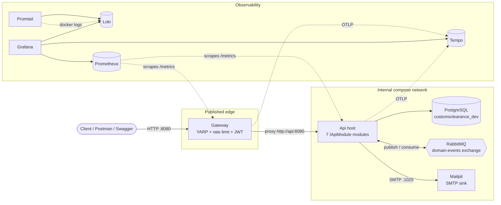
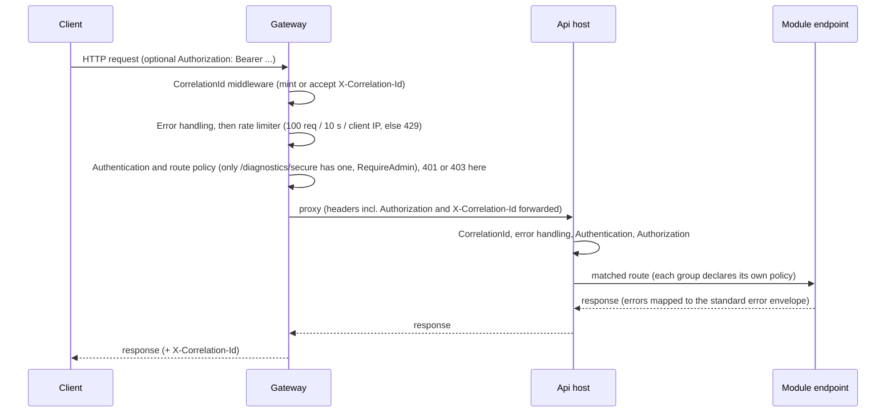
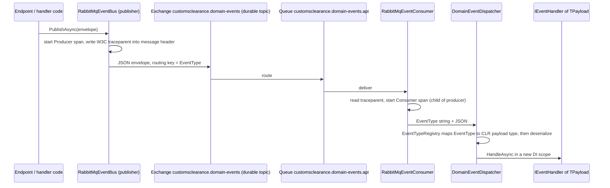

# Phase 0 Architecture Overview

State of the system after Phase 0 Days 21-40 and the Api-host module refactor of ADR-0035.
Everything here was read from the code and configuration in this repository, not from plans. Where a
statement depends on work still in flight (security hardening, CI/CD hardening, performance baseline) it is
marked with an HTML-comment reconcile placeholder instead of a guess.

Related: [C4 diagrams](../C4/README.md) | [Run locally](../runbooks/RUN-LOCALLY.md) |
[Add a module](../runbooks/ADD-A-MODULE.md) | [Deploy (what exists / what is open)](../runbooks/DEPLOY.md) |
[Parallel work rules](../PARALLEL-WORK.md)

## 1. What exists

BOSS NextGen is a **modular monolith** (ADR-0003, ADR-0006): one deployable ASP.NET Core host (`src/Api`)
fronted by one reverse-proxy host (`src/Gateway`). The 17 bounded-context folders under `src/` (Declaration,
Compliance, ...) are still empty scaffolding; Phase 0 built only the **foundation** every context will sit on.

| Component | Project | Role | ADR |
|---|---|---|---|
| Gateway | `src/Gateway` | Sole published edge: YARP reverse proxy, fixed-window rate limiter, JWT validation on selected routes, correlation-ID origination, own `/__gateway/health` and `/metrics` | 0016, 0019 |
| Api host | `src/Api` | The one application host. Cross-cutting wiring in `Program.cs`; every capability is an `IApiModule` under `src/Api/Modules/` | 0003, 0035 |
| Platform libraries | `src/Platform/*` | Shared, bounded-context-agnostic building blocks (section 6) | 0006, 0010-0012 |
| PostgreSQL 16 | compose `postgres` | One database (`customsclearance_dev`), many DbContexts | 0001, 0012 |
| RabbitMQ 3.13 | compose `rabbitmq` | Domain-event bus (durable topic exchange) | 0018 |
| Mailpit | compose `mailpit` | Dev-only SMTP sink + web UI for the email channel | 0031 |
| Observability stack | compose `loki`, `promtail`, `prometheus`, `tempo`, `grafana` | Logs, metrics, traces, dashboards, alert rules | 0020-0024 |

There is **no** cloud/hosting target, no persisted environment beyond a developer's Docker Compose, and no
production deployment (ADR-0008, ADR-0015). See [DEPLOY.md](../runbooks/DEPLOY.md).

## 2. Request flow

Decided in ADR-0016 (gateway) and ADR-0019 (defense-in-depth JWT).

Facts about this flow:

- The Gateway has two routes (`src/Gateway/appsettings.json`): `diagnostics-secure-route`
  (`/diagnostics/secure`, policy `RequireAdmin`) and a catch-all `api-route` with **no** policy. Every other
  route's authorization is decided by the Api host. Gateway auth is therefore a second check on one route, not
  a general perimeter.
- The Gateway's own endpoints (`/__gateway/health`, `/metrics`) are mapped before the proxy catch-all.
- Middleware order in both hosts: correlation ID, error handling, (Gateway: rate limiter), authentication,
  authorization.
- The Api host is not published to the host machine in compose; only `gateway` publishes a port for the app.
- Swagger UI is served by the Api host in Development only (reachable through the gateway catch-all).

- Since Day 41 (ADR-0036) a response carries exactly one `X-Correlation-Id`: `CorrelationIdMiddleware` sets
  it when the response starts, replacing the copy the Api sends back through the proxy. The E2E script
  asserts the count is 1.
- No security headers (HSTS, nosniff, CSP, etc.) are set at the Gateway, and `/metrics` is reachable through
  it without authentication. Both are open items in `docs/security/PHASE0_SECURITY_CHECKLIST.md` (7.3, 7.5).
  The Gateway's auth and route policies did not change in Day 41.

## 3. The Api host and its modules (ADR-0035)

`Program.cs` holds only host-wide wiring (logging, JSON options, authentication/authorization, token
issuance, metrics, tracing, event bus selection, middleware order). Each capability is an `IApiModule`
(`src/Api/Modules/`), discovered by reflection (`ApiModuleCatalog`), sorted by `Order`, and given four hooks:
`ConfigureServices`, `RegisterEventTypes`, `InitializeAsync` (Development only), `MapEndpoints`. Each module is
enabled only when its `ConnectionStrings:<X>Db` entry is non-blank, and the same condition guards
registration, schema bootstrap and routing (Day 18 lesson).

| Order | Module (`Name`) | Enabled by | Owns | Routes | Auth | ADR |
|---|---|---|---|---|---|---|
| 10 | `Diagnostics` | `DiagnosticsDb` | Sample `Widgets` table; `DiagnosticsWidgetCreated` event + handler; creates the physical database for the others | `/diagnostics/widgets`, `/diagnostics/secure`, `/diagnostics/throw-validation-error` (dev diagnostics) | `/secure` = Admin | 0012, 0018 |
| 20 | `Identity` | `IdentityDb` | `Users` table, dev persona seeding, password hashing | `POST /auth/login` | open (issues JWT) | 0017 |
| 30 | `RulesEngine` | `RulesDb` | `Rule` / `RuleVersion` / `RuleCondition` / `DecisionTrace` tables, evaluation pipeline | `/api/rules/*` CRUD + versions + deactivate; dev-only `/diagnostics/rules/*` (create, evaluate, evaluate-facts, trace) | Admin | 0025-0029 |
| 40 | `Configuration` | `ConfigDb` | typed key/value + feature flags, 30 s cache invalidated on write; audits changes | `/api/config/*` CRUD (+ `/{key}/effective`) | Admin | 0030 |
| 50 | `Notifications` | `NotificationsDb` | `NotificationRequested` event handling, in-app + email channels, delivery records | `GET /api/notifications/mine`, `POST /api/notifications/{id}/read`, `GET /api/notifications` (admin); dev `/diagnostics/notifications/test-event` | any user / Admin | 0031 |
| 60 | `Audit` | `AuditDb` | append-only `AuditEvents` store (replaces console audit writer) | `GET /api/audit`, `/api/audit/{id}` | Compliance Officer or Admin | 0011, 0032 |
| 70 | `ReferenceData` | `ReferenceDataDb` | countries / currencies / units tables seeded with **placeholder** data (`IsVerified=false`) | `GET /api/reference/{countries,currencies,units}` (+ `/{code}`) | any authenticated user | 0033 |

Plus `GET /health` (open) and the Prometheus `/metrics` endpoint, mapped in `Program.cs`.

Roles (from `Platform.Security`): Broker, Supervisor, ComplianceOfficer, Admin.

## 4. Data stores

- **One PostgreSQL database**, `customsclearance_dev`, shared by all modules in dev (compose sets seven
  `ConnectionStrings__*Db` variables to the same database). Each module has its **own DbContext** and its own
  tables: `DiagnosticsDbContext`, `IdentityDbContext`, `RulesDbContext`, `ConfigDbContext`,
  `NotificationsDbContext`, `AuditDbContext` (via `IDbContextFactory`, i.e. its own connection),
  `ReferenceDataDbContext`. No cross-module foreign keys.
- **No EF Core migrations yet.** In Development, each module creates its tables at start-up
  (`DatabaseBootstrap.EnsureSchemaAsync`: `EnsureCreatedAsync`, then `CreateTablesAsync` if the database
  already existed). This is a deliberate placeholder (ADR-0012, ADR-0025); a real migration pipeline is later
  work. Outside Development no schema is created.
- Provider-specific SQL is avoided so the SQL Server migration path stays open (ADR-0001).
- Persistent volumes: `postgres-dev-data`, `rabbitmq-dev-data` (named per compose project).
- Unit-of-work rule: `EfRepository` never calls `SaveChangesAsync`; the caller does, once per use case
  (ADR-0012).

- **Audit store database role (Day 41, ADR-0036).** The Audit module's runtime connection
  (`ConnectionStrings:AuditDb`) logs in as the restricted role `audit_writer`, which the database allows to
  `SELECT` and `INSERT` on `"AuditEvents"` only (plain `GRANT`/`REVOKE`, no trigger). A second, owner
  connection (`ConnectionStrings:AuditAdminDb`) is used only by the Development bootstrap to create the table,
  the role and the grants; it is idempotent. Without `AuditAdminDb` the module falls back to bootstrapping over
  the runtime connection and logs a warning (no database-level enforcement). Outside Development nothing is
  bootstrapped, so the table, role and grants must be provisioned separately. The table owner or a superuser
  can still alter rows.

## 5. Event flow (ADR-0012, ADR-0018, ADR-0024)

The contract is `DomainEventEnvelope<TPayload>` (EventId, EventType, EventVersion, OccurredAt, CorrelationId,
Source, Payload). `RabbitMq:HostName` present = real RabbitMQ; absent = `InMemoryEventBus` fallback (this is
what keeps integration tests infrastructure-free).

- Modules register their payload types in `RegisterEventTypes`. Today: `DiagnosticsWidgetCreated`
  (Diagnostics) and `NotificationRequested` (Notifications).
- Notification redelivery is idempotent (`Notification.SourceEventId` unique).
- Connection start-up retries 20 x 2 s because RabbitMQ's healthcheck passes before AMQP accepts connections
  (Days 24/25).
- The broker choice is a local-dev decision; a managed broker for hosting is open (ADR-0018, DEPLOY.md).

## 6. Platform libraries (`src/Platform/*`)

| Library | Provides | ADR |
|---|---|---|
| `Common` | Placeholder marker only | 0003 |
| `Logging` | `CorrelationIdMiddleware` / accessor, JSON structured console logging | 0010, 0020 |
| `ErrorHandling` | Exception to standard error envelope mapping (incl. malformed request -> 400) | 0010, 0028 |
| `Security` | JWT validation + token issuance, `PlatformRoles`, `PlatformPolicies` | 0011, 0017, 0019 |
| `Audit` | `IAuditWriter`, audit event model, console writer (storage-agnostic) | 0011 |
| `AuditPersistence` | Append-only PostgreSQL audit store + query service | 0032 |
| `Persistence` | `AuditableEntity`, `IRepository`, `EfRepository`, `PlatformDbContext` (auto-stamps CreatedAt/UpdatedAt) | 0012 |
| `Messaging` | Envelope, `IEventPublisher`, `IEventHandler`, in-memory + RabbitMQ buses, registry/dispatcher, telemetry | 0012, 0018, 0024 |
| `Observability` | OpenTelemetry metrics (Prometheus endpoint) + tracing (OTLP to Tempo) | 0021, 0022 |
| `RulesEngine` | Rule schema, evaluation pipeline, decision trace, effective-date validation | 0002, 0013, 0025-0029 |
| `Configuration` | `IConfigService`, typed key/value + feature flags | 0030 |
| `Notifications` | Event handler, dispatcher, in-app + SMTP email channels | 0031 |
| `ReferenceData` | Lookup entities, embedded placeholder datasets, seeder | 0033 |
| `Eventing`, `Workflow` | Empty folders (reserved) | - |

Library-to-host direction: libraries never reference `src/Api`; the Api references the libraries. No bounded
context references another (checked manually; automation is an ADR-0006 follow-up).

## 7. Observability stack (ADR-0020 to ADR-0024)

| Signal | Producer | Transport | Store | UI |
|---|---|---|---|---|
| Logs | Api + Gateway: JSON to stdout, `CorrelationId` field | Promtail scrapes Docker logs (`observability/promtail-config.yaml`) | Loki | Grafana (Loki datasource) |
| Metrics | OpenTelemetry (ASP.NET Core HTTP metrics) at `/metrics` | Prometheus scrape every 15 s (`observability/prometheus.yml`, jobs `customsclearance-api`, `customsclearance-gateway`) | Prometheus | Grafana dashboard `api-gateway-overview` (5 panels) |
| Traces | OpenTelemetry ASP.NET Core + HttpClient + custom messaging source, spans tagged with CorrelationId | OTLP gRPC to Tempo `:4317` | Tempo (local disk) | Grafana (Tempo datasource, trace-to-logs on `correlation_id`) |
| Alerts | Grafana unified alerting, `observability/alerting/rules.yaml`: Service Down (critical), High 5xx Error Rate (warning) | - | Grafana | Grafana Alerting. **No contact point**: state only, nothing is delivered |

One request that also publishes an event produces a five-span trace (Gateway inbound, Gateway proxy, Api
inbound, event publish, event receive) and matching log lines, a metric increment and (on failure) an alert
state change, all joined by the same correlation ID (ADR-0024).

Grafana runs with anonymous Admin access and no login form: dev-only.

## 8. Host ports

Default (slot 0) ports published by `docker-compose.yml`. Every one is overridable by an env var; slot N of
`build/scripts/agent-env.sh` shifts each by N x 1000 (SMTP by N). Not published: `api` (8080 inside the
network only), `promtail`.

| Service | Container port | Default host port | Env var | Purpose |
|---|---|---|---|---|
| gateway | 8080 | 8080 | `GATEWAY_PORT` | The application entry point |
| postgres | 5432 | 5432 | `POSTGRES_PORT` | Direct `psql` / `dotnet run` against compose DB |
| rabbitmq | 5672 | 5672 | `RABBITMQ_PORT` | AMQP (for `dotnet run` outside Docker) |
| rabbitmq | 15672 | 15672 | `RABBITMQ_MGMT_PORT` | Management UI (guest/guest, dev only) |
| mailpit | 1025 | 1025 | `MAILPIT_SMTP_PORT` | SMTP sink |
| mailpit | 8025 | 8025 | `MAILPIT_UI_PORT` | Inbox UI + HTTP API |
| grafana | 3000 | 3000 | `GRAFANA_PORT` | Dashboards, log/trace explore, alerts |
| prometheus | 9090 | 9090 | `PROMETHEUS_PORT` | Metrics query UI |
| loki | 3100 | 3100 | `LOKI_PORT` | Log API |
| tempo | 4317 | 4317 | `TEMPO_OTLP_PORT` | OTLP gRPC ingest |
| tempo | 3200 | 3200 | `TEMPO_HTTP_PORT` | Trace query API |

## 9. Testing layers (ADR-0009, ADR-0007)

| Layer | Where | Needs infrastructure? | Gate |
|---|---|---|---|
| Unit | `tests/Unit/*` (one project per platform library; xUnit + coverlet.msbuild) | No (EF InMemory) | 95% line for core logic, 80% for CRUD/master data, per project |
| Integration | `tests/Integration/Api.IntegrationTests` (`WebApplicationFactory`) | No: `TestApiFactory` blanks every connection string and `RabbitMq:HostName` | pass/fail |
| API contract | `postman/` via `build/scripts/contract-test.sh` (Newman) | Yes: running stack on `localhost:8080` | pass/fail |
| Container smoke | `build/scripts/smoke-test.sh` | Yes: builds and runs compose | pass/fail |
| End-to-end smoke | `build/scripts/e2e-smoke-test.sh` (20 checks, evidence file) | Yes | pass/fail |

`tests/Performance/` and `tests/Security/` exist but are empty.

<!-- RECONCILE-AFTER-42: Performance baseline - numbers, tool, scenarios, where results live (Day 42, not started yet) -->

## 10. Security posture (what is true today)

Facts verified in code/config at the time of writing:

- JWT bearer (HS256 symmetric key) validated by both Gateway and Api from the same `Jwt` config section
  (issuer, audience, key). Tokens are issued by `POST /auth/login`. Role-based policies live in
  `Platform.Security`.
- The only key in the repo is a clearly marked dev placeholder in `appsettings*.json`; compose uses
  `devlocalonly` as the Postgres password and `guest/guest` for RabbitMQ. All of it is dev-only.
  Since Day 41, outside Development both hosts refuse to start if `Jwt:Key` is the placeholder or shorter than
  32 bytes (`JwtKeyValidator`); compose supplies the key as `Jwt__Key=${JWT_KEY:-<dev placeholder>}`. There is
  no vault and no rotation process yet.
- Both Dockerfiles now default `ASPNETCORE_ENVIRONMENT` to `Production`; `docker-compose.yml` sets
  `Development` explicitly for the local and CI stack.
- Dev personas are seeded only in Development (see RUN-LOCALLY.md).
- Audit is a durable append-only store enforced in the application (`SaveChanges` rejects update/delete)
  **and, since Day 41, at the database level** by the restricted `audit_writer` role (see section 4).
- Personal data (notification recipient address) still travels in the event payload (ADR-0031). Day 41 only
  redacts the address from SMTP error text before it is logged or stored; removing it from the payload needs a
  user-profile lookup and is an open decision. DPDPA 2023 handling is a standing requirement (ADR-0004).
- The full item-by-item status (PASS / FIXED / ACCEPTED-GAP / OPEN) is
  `docs/security/PHASE0_SECURITY_CHECKLIST.md`. Open decisions include MFA, the 8-hour token lifetime, login
  lockout, security headers, `/metrics` exposure and audit retention.

## 11. CI/CD (summary of what the repo defines)

`.github/workflows/ci.yml` (GitHub Actions) defines these jobs, mirrored in `build/azure-pipelines.yml`
(parked, ADR-0005): Build, Lint, Unit Tests + Coverage Gate, Integration Tests, Containerize + Dev
Environment Smoke Test, API Contract Tests, End-to-End Smoke Test. Each job runs a portable script from
`build/scripts/`. Static analysis is SonarAnalyzer.CSharp via `Directory.Build.props`; no SonarQube server
(ADR-0007). Continuous *deployment* does not exist (ADR-0008).

Day 43 (ADR-0038) added:

- **Dependency Scan (SCA)**: `build/scripts/dependency-scan.sh` runs `dotnet list package --vulnerable
  --include-transitive`; High/Critical advisories fail, Moderate/Low warn, and it refuses to report clean if
  the advisory data could not be fetched. Dated exceptions go in `build/dependency-scan-allowlist.txt`
  (empty). Test-project transitive pins live in `tests/Directory.Build.props`.
- **Secret Scan**: `build/scripts/secret-scan.sh` runs gitleaks over the full git history with
  `.gitleaks.toml`, which allowlists only the two committed dev placeholders by exact value.
- **CodeQL** (C#) in its own workflow, `.github/workflows/codeql.yml`; it has no Azure Pipelines equivalent
  (a documented lockstep exception). Dependabot is configured in `.github/dependabot.yml`.
- **`CI passed`**: one aggregate job that needs the nine gating jobs and fails unless every one succeeded.
  It is the single check name branch protection is meant to require (plus CodeQL's own check).
- **Branch protection is not enabled.** `docs/BRANCH-PROTECTION.md` has the exact command; until it is run,
  none of these gates can block a merge or a direct push. None of the new jobs had run on GitHub when this
  was written.

## 12. Known limits and carry-forwards

- No bounded-context business logic yet; all 17 context folders are empty.
- Reference data is placeholder, not verified against official masters (ADR-0033).
- Alert notifications are not delivered anywhere (ADR-0023).
- Rules-engine authoring is minimal; Re-Segregation events and manual override are not built (ADR-0013).
- `OpenTelemetry.Exporter.OpenTelemetryProtocol` 1.9.0 carries advisory NU1902, judged not exploitable here
  (ADR-0022).
- The cross-context `ProjectReference` check is manual (ADR-0006).
- Hosting, cloud, managed broker/database, secrets store, TLS: all undecided (ADR-0008, ADR-0015).
