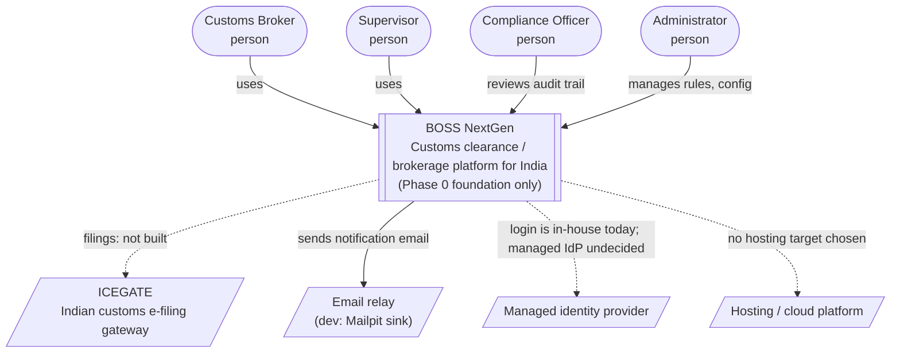
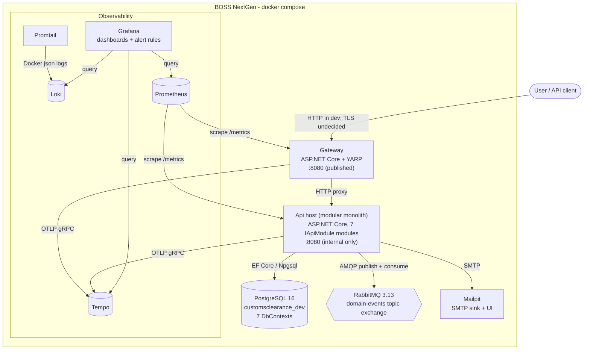

# C4 Diagrams (Phase 0)

C4 levels 1 (system context) and 2 (containers) as Mermaid `flowchart`s, which GitHub renders directly. The
experimental Mermaid C4 syntax is deliberately not used. Level 3 (components) is not drawn: the Api host's
internal structure is the module table in [the architecture overview](../Architecture/README.md#3-the-api-host-and-its-modules-adr-0035).

Scope: what is built after Phase 0. External systems that appear in the product requirements but have **no
integration yet** are drawn dashed and labelled "not built".

## Level 1 - System context

Notes:

- Personas are PRD Ch.1.7 roles (`Broker`, `Supervisor`, `ComplianceOfficer`, `Admin`) and map 1:1 to
  `PlatformRoles`.
- ICEGATE integration belongs to the `CustomsGatewayIntegration` bounded context, which is still empty.
- Login is an in-house JWT issuer (ADR-0017). A managed identity provider is a possible later change.
- Real SMTP relay and hosting are undecided (ADR-0008, ADR-0015); in dev, Mailpit receives all mail.

## Level 2 - Containers

| Container | Technology | Responsibility | Defined in |
|---|---|---|---|
| Gateway | .NET 8, ASP.NET Core, YARP | Only published application port; rate limiting, selected-route JWT validation, correlation-ID origination | `src/Gateway`, `src/Gateway/Dockerfile` |
| Api host | .NET 8, ASP.NET Core, EF Core 8 + Npgsql | All Phase 0 capabilities as modules; publishes and consumes domain events | `src/Api`, `src/Api/Dockerfile` |
| PostgreSQL | `postgres:16-alpine` | Single database, one schema per module's tables | `docker-compose.yml` |
| RabbitMQ | `rabbitmq:3.13-management-alpine` | Event bus | `docker-compose.yml` |
| Mailpit | `axllent/mailpit:v1.21` | Dev SMTP sink | `docker-compose.yml` |
| Loki / Promtail | `grafana/loki:2.9.8`, `grafana/promtail:2.9.8` | Log store / log shipping | `observability/` |
| Prometheus | `prom/prometheus:v2.54.1` | Metrics store | `observability/prometheus.yml` |
| Tempo | `grafana/tempo:2.5.0` | Trace store | `observability/tempo.yaml` |
| Grafana | `grafana/grafana:11.1.0` | UI; provisioned datasources, dashboard, alert rules | `observability/` |

The only two images built from this repo are the Gateway and the Api host; the rest are pulled upstream
images with configuration mounted from `observability/`.

<!-- RECONCILE-AFTER-41-43: Any container/trust-boundary change from Day 41 (e.g. TLS termination, secrets source, DB roles) or Day 43 (e.g. image scanning) that alters this diagram - from Workers doing Day 41 and Day 43 -->
